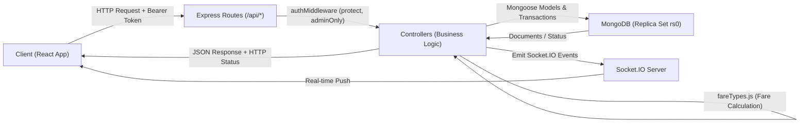

# SkyStream Flight Booking System — Backend Architecture Documentation

====================================================================
## 1. WHAT WAS BUILT IN THIS LAYER AND WHY
====================================================================

The backend of **SkyStream** is an enterprise-grade RESTful API built on **Node.js** and **Express.js**, integrated with **Mongoose ODM** operating on a MongoDB single-node replica set (`rs0`) for multi-document ACID transactions, and **Socket.IO** for event-driven real-time notifications.

### Key Architectural Enhancements
1. **Centralized Fare Category Engine (`server/config/fareTypes.js`):**
   - Configures 4 passenger concession tiers:
     - `Regular`: 0% concession
     - `Student`: 10% concession on base fare (mandates Student ID & Institution)
     - `Armed Forces`: 15% concession on base fare (mandates Military/Service ID & Branch)
     - `Senior Citizen`: 12% concession on base fare (mandates passenger age ≥ 60)
   - Exposes `calculateFareBreakdown()` which computes `baseFare`, `discountPercent`, `discountAmount`, `subtotal`, `taxAmount` (12% GST), and `totalAmount`.
   - The backend is the **sole source of truth** for financial figures, preventing client-side price tampering.

2. **Expanded Flight Model & Fleet Telemetry:**
   - Supports 3-letter IATA airport codes (`sourceCode`, `destinationCode`), aircraft equipment models (e.g. `Boeing 787-9 Dreamliner`, `Airbus A321neo`), intermediate stops count (`0` for non-stop, `1`, `2`), terminal designations, and boarding gate assignments.
   - Enhanced search query pipeline supporting sorting by `cheapest`, `fastest`, and `recommended`, alongside filter clauses for `stops`, `airline`, `timeSlot`, and `price`.

3. **Atomic Multi-Document Reservation Transactions:**
   - Multi-document transactions (`session.withTransaction()`) guarantee that seat reservation, passenger creation, booking persistence, and seat inventory decrement execute as an indivisible unit of work.
   - If any seat is already booked or concurrency conflicts occur, the transaction rolls back cleanly, avoiding phantom reservations.

4. **Socket.IO Real-Time Dispatch:**
   - Emits events (`booking:created`, `booking:cancelled`, `notification:new`, `flight:status`) only after transaction commits succeed.

---

====================================================================
## 2. BACKEND ARCHITECTURE & DIRECTORY STRUCTURE
====================================================================

```text
server/
├── server.js                      # Express HTTP server & Socket.IO initialization
├── package.json                   # Dependencies (express, mongoose, cors, dotenv, bcryptjs, jsonwebtoken, socket.io)
├── .env                           # Server configuration (PORT, MONGODB_URI, JWT_SECRET, CLIENT_ORIGIN)
├── .gitignore                     # Ignores node_modules and .env
├── config/
│   ├── db.js                      # MongoDB connection manager with Mongoose
│   └── fareTypes.js               # Centralized fare rules, discounts & calculateFareBreakdown engine
├── utils/
│   └── generateToken.js           # JWT token generation utility using HMAC-SHA256
├── middleware/
│   ├── authMiddleware.js          # protect (JWT verification) & adminOnly (role authorization)
│   └── errorMiddleware.js         # Centralized notFound and errorHandler middleware
├── models/
│   ├── User.js                    # User account schema with bcrypt password hashing hooks
│   ├── Flight.js                  # Flight schedule, routes, equipment, stops, terminals, gates & indexes
│   ├── Seat.js                    # Aircraft seat layout with compound unique index (flightId + seatNumber)
│   ├── Passenger.js               # Passenger identity records linked to bookings
│   ├── Booking.js                 # Reservation records with fareType and fareBreakdown
│   └── Notification.js            # User alerts for booking changes and flight updates
├── routes/
│   ├── authRoutes.js              # /api/auth endpoints (register, login, me, profile)
│   ├── flightRoutes.js            # /api/flights endpoints (search, filters, stops, CRUD)
│   ├── seatRoutes.js              # /api/flights/:id/seats endpoints
│   ├── bookingRoutes.js           # /api/bookings endpoints (atomic reservation, cancel, status)
│   ├── passengerRoutes.js         # /api/passengers endpoints
│   ├── adminRoutes.js             # /api/admin endpoints (dashboard metrics, user/booking mgmt)
│   └── notificationRoutes.js      # /api/notifications endpoints
└── controllers/
    ├── authController.js          # Authentication and user profile logic
    ├── flightController.js        # Flight search with stops/time/sort, pagination, and seat generation
    ├── seatController.js          # Aircraft seat query and availability summaries
    ├── bookingController.js       # Atomic booking creation with fare concessions and cancellation
    ├── passengerController.js     # Passenger retrieval and modification
    ├── adminController.js         # Analytics aggregation, user directory and fleet scheduler
    └── notificationController.js  # User notifications and read status updates
```

---

====================================================================
## 3. REQUEST FLOW & MVC ARCHITECTURE
====================================================================



### End-to-End Request Pipeline:
1. **CORS & Body Parser:** Validates origin header (`http://localhost:5173`) and parses JSON bodies up to `100kb`.
2. **Authentication Middleware:**
   - `protect`: Extracts Bearer token from `Authorization` header, verifies signature using `JWT_SECRET`, queries database for user identity (excluding hashed password), and attaches `req.user`.
   - `adminOnly`: Verifies `req.user.role === 'admin'`.
3. **Controller Execution:**
   - Reads inputs, sanitizes string fields, checks ObjectIds with `mongoose.isValidObjectId()`.
   - In booking creation, executes `calculateFareBreakdown()` based on the verified fare category.
4. **Mongoose Database Operations:**
   - Executes atomic transaction via `mongoose.startSession()`.
   - Writes new booking document, creates passenger sub-records, locks and marks seats as `booked`, decrements `availableSeats` on the flight.
5. **Real-Time Notification Dispatch:**
   - Emits `booking:created` or `booking:cancelled` through Socket.IO.
6. **Centralized Error Handling:**
   - All asynchronous errors pass to `next(err)` and are formatted consistently by `errorHandler`.

---

====================================================================
## 4. REST API ROUTES SPECIFICATION
====================================================================

### 1. Authentication Routes (`/api/auth`)

| Method | Endpoint | Access | Description |
|---|---|---|---|
| `POST` | `/api/auth/register` | Public | Registers a new passenger account (default role: `user`). |
| `POST` | `/api/auth/login` | Public | Authenticates credentials and returns user profile + JWT. |
| `GET` | `/api/auth/me` | Protected | Fetches authenticated user profile from token. |
| `PUT` | `/api/auth/profile` | Protected | Updates name, phone, or changes password (requires current password). |

### 2. Flight Routes (`/api/flights`)

| Method | Endpoint | Access | Query Parameters / Body | Description |
|---|---|---|---|---|
| `GET` | `/api/flights` | Public | `source`, `destination`, `departureDate`, `travelClass`, `stops`, `airline`, `minPrice`, `maxPrice`, `timeSlot`, `sort` (`cheapest`, `fastest`, `recommended`) | Queries flights matching criteria across 58 seeded records. |
| `GET` | `/api/flights/:id` | Public | None | Returns single flight details with full schedule, terminals, and baggage. |
| `POST` | `/api/flights` | Admin | `{ airline, flightNumber, source, sourceCode, destination, destinationCode, departureDate, departureTime, arrivalTime, duration, price, travelClass, stops, aircraft, terminal, gate, ... }` | Creates new flight and generates 60 seats automatically. |
| `PUT` | `/api/flights/:id` | Admin | Update fields (`status`, `departureTime`, `gate`, etc.) | Modifies flight schedule and emits real-time status change. |
| `DELETE` | `/api/flights/:id` | Admin | None | Removes flight if no active bookings exist. |

### 3. Seat Routes (`/api/flights/:id/seats`)

| Method | Endpoint | Access | Description |
|---|---|---|---|
| `GET` | `/api/flights/:id/seats` | Public | Returns all 60 seat records for the flight with seat numbers, classes, status (`available`/`booked`), and pricing. |
| `GET` | `/api/flights/:id/seats/availability` | Public | Returns summary object `{ totalSeats, bookedSeats, availableSeats }`. |

### 4. Booking Routes (`/api/bookings`)

| Method | Endpoint | Access | Request Body | Description |
|---|---|---|---|---|
| `POST` | `/api/bookings` | Protected | `{ flightId, selectedSeats: ["1A", "1B"], fareType: "Student", passengers: [...] }` | Executes atomic booking creation with concession calculation. |
| `GET` | `/api/bookings/my` | Protected | None | Returns all reservations for the logged-in passenger. |
| `GET` | `/api/bookings/:id` | Protected | None | Returns boarding pass details, populated flight, passengers, and fare breakdown. |
| `PUT` | `/api/bookings/:id/cancel` | Protected | None | Atomically cancels reservation, releases seat locks, and increments available seats. |

### 5. Admin & Analytics Routes (`/api/admin`)

| Method | Endpoint | Access | Description |
|---|---|---|---|
| `GET` | `/api/admin/dashboard` | Admin | Returns aggregate metrics: total revenue, total bookings, active users, total flights, and recent reservations. |
| `GET` | `/api/admin/users` | Admin | Returns all registered users with pagination. |
| `PUT` | `/api/admin/users/:id/role` | Admin | Updates user role between `user` and `admin`. |
| `GET` | `/api/admin/bookings` | Admin | System-wide reservation logs with passenger inspection. |

---

====================================================================
## 5. FARE CALCULATION & CONCESSION RULES
====================================================================

The fare calculation formula implemented in `server/config/fareTypes.js` is strictly defined as:

$$\text{Seat Fare} = \text{Flight Base Price} + \text{Seat Tier Surcharge}$$
$$\text{Base Total} = \sum \text{Seat Fares}$$
$$\text{Discount Amount} = \text{Base Total} \times \text{Discount Percent}$$
$$\text{Subtotal} = \text{Base Total} - \text{Discount Amount}$$
$$\text{Tax Amount (12\% GST)} = \text{Subtotal} \times 0.12$$
$$\text{Total Amount} = \text{Subtotal} + \text{Tax Amount}$$

### Concession Validation Constraints:
- **Student Concession:** Requires at least one passenger to possess a verified Student ID and educational institution name.
- **Armed Forces Concession:** Requires military service identification number and service branch.
- **Senior Citizen Concession:** Strictly verifies that every concessionary passenger's age is $\ge 60$ years. If age is $< 60$, the controller rejects the request with HTTP `400 Bad Request`.
