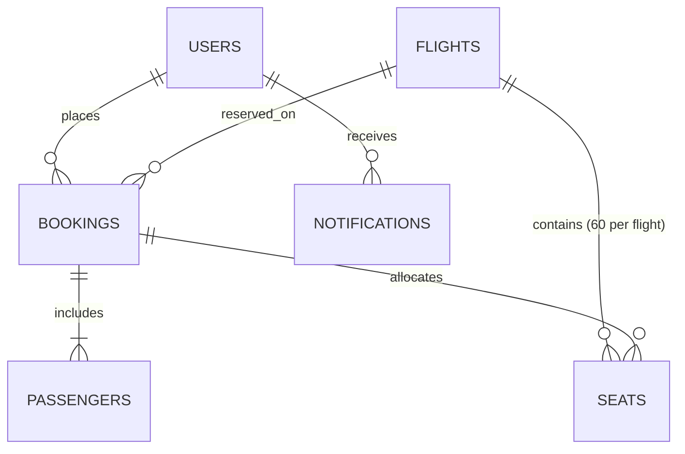

# SkyStream Flight Booking System — MongoDB & Database Architecture

====================================================================
## 1. WHAT WAS BUILT IN THIS LAYER AND WHY
====================================================================

The persistence layer of **SkyStream** is built on **MongoDB Community Server** running locally on port `27017` configured as a single-node replica set named `rs0`. It is managed through **Mongoose ODM (Object Data Modeling)** in Node.js.

### Why a Replica Set (`rs0`)?
MongoDB requires a replica set to execute **multi-document ACID transactions**. In an airline reservation system:
1. When a user books a flight, multiple collections must update concurrently:
   - Mark selected `Seat` documents as `booked`
   - Decrement `availableSeats` on the `Flight` document
   - Insert new `Passenger` records
   - Create the parent `Booking` document
   - Emit a `Notification`
2. If any step fails (e.g. another passenger books the exact same seat a millisecond earlier), the transaction aborts and all operations roll back to maintain 100% data integrity with **zero double bookings**.

---

====================================================================
## 2. COLLECTIONS, SCHEMAS & FIELD SPECIFICATIONS
====================================================================

The `skystream` database contains 6 distinct collections:

---

### Collection 1: `users`
Stores registered customer accounts and administrative staff credentials.

| Field | Type | Required | Constraints | Purpose |
|---|---|---|---|---|
| `_id` | ObjectId | Auto | Primary Key | Unique user identifier |
| `name` | String | Yes | Trimmed, 2-100 chars | Full legal name |
| `email` | String | Yes | Unique, Lowercase, Regex | Login identity & notifications |
| `password` | String | Yes | Min 6 chars, `select: false` | Bcryptjs hash (cost factor 12) |
| `phone` | String | No | Trimmed, default: `""` | Contact phone number |
| `role` | String | Yes | Enum: `['user', 'admin']` (default: `'user'`) | Access control level |
| `createdAt` | Date | Auto | Timestamps | Account creation timestamp |
| `updatedAt` | Date | Auto | Timestamps | Last profile update timestamp |

---

### Collection 2: `flights`
Stores commercial flight schedules, routes, equipment, terminals, and live operational status.

| Field | Type | Required | Constraints | Purpose |
|---|---|---|---|---|
| `_id` | ObjectId | Auto | Primary Key | Unique flight identifier |
| `airline` | String | Yes | Trimmed, Enum (Air India, IndiGo, SpiceJet, Vistara, Akasa Air, Emirates, British Airways, Singapore Airlines, Qatar Airways) | Carrier name |
| `flightNumber` | String | Yes | Unique, Uppercase, Trimmed (e.g., `AI-101`) | Flight identification code |
| `source` | String | Yes | Trimmed (e.g., `Delhi (DEL)`) | Departure airport |
| `sourceCode` | String | Yes | Uppercase, 3 chars (e.g., `DEL`) | Departure IATA code |
| `destination` | String | Yes | Trimmed (e.g., `Mumbai (BOM)`) | Arrival airport |
| `destinationCode` | String | Yes | Uppercase, 3 chars (e.g., `BOM`) | Arrival IATA code |
| `departureDate` | Date | Yes | Valid Date | Scheduled departure date |
| `departureTime` | String | Yes | Trimmed (e.g., `06:00 AM`) | Departure time of day |
| `arrivalTime` | String | Yes | Trimmed (e.g., `08:15 AM`) | Scheduled landing time |
| `duration` | String | Yes | Trimmed (e.g., `2h 15m`) | En-route duration |
| `price` | Number | Yes | Min: `0` | Base ticket price per seat |
| `totalSeats` | Number | Yes | Default: `60`, Min: `1` | Total aircraft capacity |
| `availableSeats` | Number | Yes | Default: `totalSeats` | Real-time seat inventory |
| `travelClass` | String | Yes | Enum: `['Economy', 'Business', 'First Class']` | Cabin category |
| `stops` | Number | Yes | Default: `0`, Min: `0` | Intermediate layover stops |
| `aircraft` | String | Yes | Default: `'Boeing 737-800'` | Aircraft equipment type |
| `terminal` | String | Yes | Default: `'T3'` | Airport departure terminal |
| `gate` | String | Yes | Default: `'A12'` | Boarding gate |
| `status` | String | Yes | Enum: `['scheduled', 'delayed', 'cancelled', 'completed']` | Live operational state |
| `baggageInformation` | String | No | Default: `'Cabin: 7kg, Check-in: 15kg'` | Included luggage allowance |

---

### Collection 3: `seats`
Stores individual physical seat reservations for each flight (60 seats per flight).

| Field | Type | Required | Constraints | Purpose |
|---|---|---|---|---|
| `_id` | ObjectId | Auto | Primary Key | Unique seat document ID |
| `flightId` | ObjectId | Yes | Ref: `Flight` | Foreign reference to flight |
| `seatNumber` | String | Yes | Uppercase, Pattern: `^[1-9][0-9]?[A-F]$` (e.g., `1A`, `10F`) | Seat grid coordinates |
| `seatClass` | String | Yes | Enum: `['Economy', 'Business', 'First Class']` | Seat cabin tier |
| `price` | Number | Yes | Min: `0` | Specific price (base + seat surcharge) |
| `status` | String | Yes | Enum: `['available', 'booked']` (default: `'available'`) | Availability lock |

**Compound Index:** `{ flightId: 1, seatNumber: 1 }` with `{ unique: true }`.

---

### Collection 4: `bookings`
Stores reservation records, PNRs, fare categories, discount calculations, and payment statuses.

| Field | Type | Required | Constraints | Purpose |
|---|---|---|---|---|
| `_id` | ObjectId | Auto | Primary Key | Unique booking ID |
| `pNR` | String | Yes | Unique, Uppercase, 6 alphanumeric chars (e.g., `SKY942`) | Passenger Name Record |
| `user` | ObjectId | Yes | Ref: `User` | Customer who booked the ticket |
| `flight` | ObjectId | Yes | Ref: `Flight` | Reserved flight document |
| `seats` | Array of Strings | Yes | Min length: 1 (e.g., `["3A", "3B"]`) | Booked seat numbers |
| `fareType` | String | Yes | Enum: `['Regular', 'Student', 'Armed Forces', 'Senior Citizen']` | Concession category |
| `fareBreakdown` | Object | Yes | Detailed pricing sub-document | Financial audit ledger |
| `fareBreakdown.baseFare` | Number | Yes | Min: 0 | Gross fare before discounts |
| `fareBreakdown.discountPercent` | Number | Yes | Min: 0, Max: 100 | Percentage concession |
| `fareBreakdown.discountAmount` | Number | Yes | Min: 0 | Absolute amount deducted |
| `fareBreakdown.subtotal` | Number | Yes | Min: 0 | Net fare |
| `fareBreakdown.taxAmount` | Number | Yes | Min: 0 | 12% GST tax amount |
| `fareBreakdown.totalAmount` | Number | Yes | Min: 0 | Final billed amount |
| `totalPrice` | Number | Yes | Matches `fareBreakdown.totalAmount` | Compatibility legacy total |
| `status` | String | Yes | Enum: `['confirmed', 'cancelled', 'pending']` | Reservation lifecycle |
| `paymentStatus` | String | Yes | Enum: `['paid', 'pending', 'refunded']` | Transaction status |
| `passengers` | Array of ObjectIds | Yes | Ref: `Passenger` | Array of traveler documents |

---

### Collection 5: `passengers`
Stores individual traveler credentials for each booked seat.

| Field | Type | Required | Constraints | Purpose |
|---|---|---|---|---|
| `_id` | ObjectId | Auto | Primary Key | Unique passenger identifier |
| `booking` | ObjectId | Yes | Ref: `Booking` | Linked booking record |
| `name` | String | Yes | Trimmed, 2-100 chars | Full legal name |
| `age` | Number | Yes | Min: 0, Max: 120 | Passenger age |
| `gender` | String | Yes | Enum: `['Male', 'Female', 'Other']` | Gender identity |
| `seatNumber` | String | Yes | Trimmed (e.g., `3A`) | Assigned seat |
| `idNumber` | String | Yes | Uppercase, Trimmed | Passport / National ID / Student ID |
| `email` | String | No | Trimmed, lowercase | Optional contact email |

---

### Collection 6: `notifications`
Stores real-time system alerts for passengers and administrators.

| Field | Type | Required | Constraints | Purpose |
|---|---|---|---|---|
| `_id` | ObjectId | Auto | Primary Key | Notification identifier |
| `user` | ObjectId | Yes | Ref: `User` | Recipient user |
| `type` | String | Yes | Enum: `['booking', 'flight', 'system']` | Category of alert |
| `title` | String | Yes | Trimmed | Notification headline |
| `message` | String | Yes | Trimmed | Body text |
| `read` | Boolean | Yes | Default: `false` | Unread badge flag |

---

====================================================================
## 3. SEEDED DATABASE OVERVIEW (58 FLIGHTS & 3,480 SEATS)
====================================================================

The database seed script (`database/seed.js`) populates **58 realistic commercial flights** covering:
- **Major Indian Metros & Hubs:** Delhi (DEL), Mumbai (BOM), Bengaluru (BLR), Chennai (MAA), Hyderabad (HYD), Pune (PNQ), Kolkata (CCU), Ahmedabad (AMD), Goa (GOI), Kochi (COK).
- **International Gateways:** Dubai (DXB), London Heathrow (LHR), Singapore Changi (SIN), Bangkok Suvarnabhumi (BKK), Doha Hamad (DOH), Abu Dhabi (AUH), New York (JFK), Tokyo Haneda (HND).
- **Fleet Carriers:** Air India, IndiGo, Vistara, SpiceJet, Akasa Air, Emirates, Singapore Airlines, British Airways, Qatar Airways.
- **Seat Capacity:** $58 \text{ flights} \times 60 \text{ seats} = \mathbf{3,480 \text{ physical seat documents}}$.
